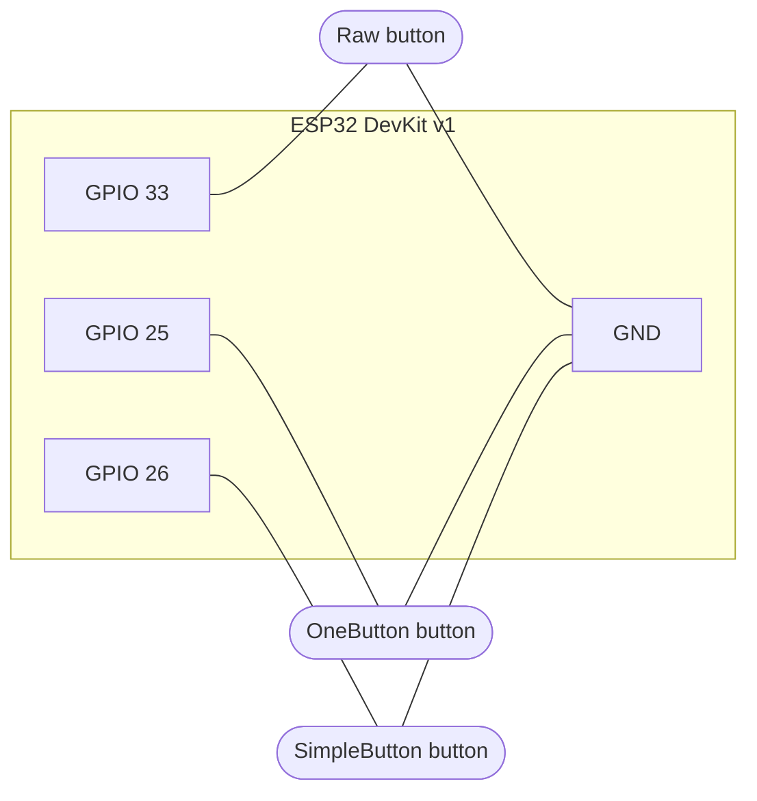

# Button debounce

An ESP32 example that compares three ways of reading a push button:

| Button | GPIO | Method | What you see in the log |
|---|---|---|---|
| **Raw** | **GPIO 33** | `digitalRead()`, no debounce | Every edge, including contact bounce |
| **OneButton** | **GPIO 25** | [OneButton](https://github.com/mathertel/OneButton) library | `click`, `double click`, `long press` |
| **SimpleButton** | **GPIO 26** | Own class in [lib/SimpleButton](lib/SimpleButton) | One event per press (50 ms lockout debounce) |

Pin assignments are defined in [include/pins.h](include/pins.h).

## Wiring

Each button connects between its GPIO and **GND**. No resistors are needed, because every pin uses the ESP32's internal pull-up (`INPUT_PULLUP`):

- **Released:** the pull-up holds the pin at 3.3V, so it reads `HIGH`.
- **Pressed:** the button shorts the pin to GND, so it reads `LOW`.



The same wiring as a schematic:

```
            ESP32 DevKit v1
          ┌─────────────────┐
          │                 │      Raw
          │         GPIO 33 ├──────o  o──────┐
          │                 │      OneButton  │
          │         GPIO 25 ├──────o  o──────┤
          │                 │      Simple     │
          │         GPIO 26 ├──────o  o──────┤
          │                 │                 │
          │             GND ├─────────────────┘
          └─────────────────┘
```

> **4-pin tactile buttons:** the two pins on each long side are connected internally. Use two **diagonally opposite** pins so you're sure to go through the switch.

## Build and run

```sh
pio run -t upload
pio device monitor
```

The serial monitor runs at 115200 baud. Events are collected and printed about once per second. Press each button and compare the output: the raw button usually shows several edges for one press, while SimpleButton shows exactly one.

Log verbosity is set with `LOG_LEVEL` in [platformio.ini](platformio.ini).
