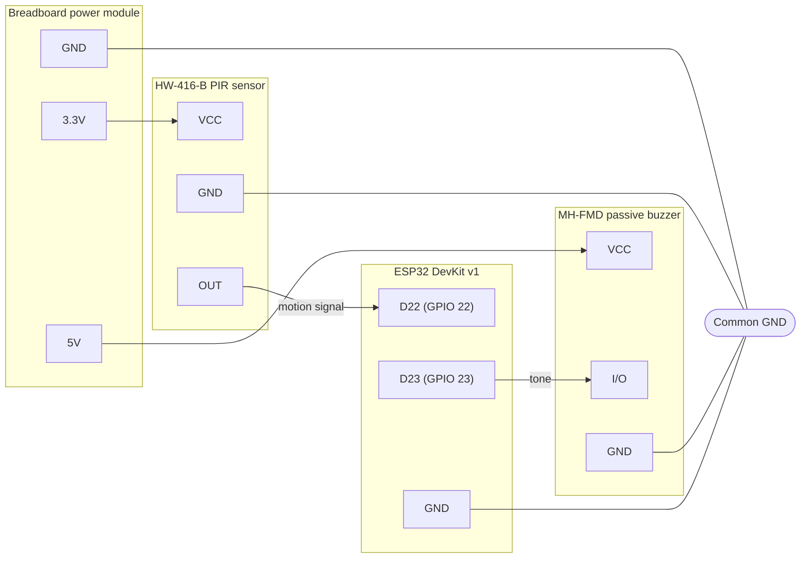

# Motion sensor + buzzer

An ESP32 example that plays a sound when something moves. A PIR motion sensor watches the room, and each time it detects motion the ESP32 plays a **random note** from an array on a passive buzzer.

| Module | Role | ESP32 pin | Powered from |
|---|---|---|---|
| **HW-416-B** | PIR motion sensor, `OUT` goes `HIGH` on motion | **D22** (GPIO 22), input | **3.3V** rail |
| **MH-FMD** | Passive buzzer module, driven with `tone()` | **D23** (GPIO 23), output | **5V** rail |

## How it works

1. The PIR sensor pulls `OUT` `HIGH` when it sees motion and drops it back to `LOW` after the hold time.
2. The ESP32 watches D22 for a `LOW` → `HIGH` edge.
3. On each edge it picks a random note from the notes array and plays it on D23 for a short time.

The sensor's **time delay** potentiometer is turned to the minimum, so `OUT` goes back to `LOW` quickly and the next movement creates a new edge. This way almost every movement plays a note.

## Wiring

The breadboard power module has two separate rails: **5V** and **3.3V**. The ESP32 is powered over USB. All grounds are tied together: the power module, both modules, and the ESP32 `GND` pin share one common ground.

| From | To |
|---|---|
| Power module 3.3V | HW-416-B `VCC` |
| HW-416-B `OUT` | ESP32 D22 |
| Power module 5V | MH-FMD `VCC` |
| ESP32 D23 | MH-FMD `I/O` |
| HW-416-B `GND`, MH-FMD `GND`, power module `GND`, ESP32 `GND` | Common ground |



The same wiring as a schematic:

```
   Breadboard power module
  ┌───────────────────────┐
  │   3.3V    5V     GND  │
  └────┬──────┬───────┬───┘
       │      │       │
       │      │       │            HW-416-B (PIR)
       │      │       │          ┌──────────────┐
       └──────┼───────┼──────────┤ VCC          │
              │       │   ┌──────┤ OUT          │
              │       ├───┼──────┤ GND          │
              │       │   │      └──────────────┘
              │       │   │
              │       │   │        MH-FMD (buzzer)
              │       │   │      ┌──────────────┐
              └───────┼───┼──────┤ VCC          │
                      │   │  ┌───┤ I/O          │
                      ├───┼──┼───┤ GND          │
                      │   │  │   └──────────────┘
                      │   │  │
                      │   │  │      ESP32 DevKit v1
                      │   │  │   ┌─────────────────┐
                      │   └──┼───┤ D22 (GPIO 22)   │
                      │      └───┤ D23 (GPIO 23)   │
                      └──────────┤ GND             │
                                 │                 ├── USB
                                 └─────────────────┘
```

## Sensor settings

The HW-416-B has two potentiometers and a trigger jumper:

- **Time delay** (how long `OUT` stays `HIGH`): set to **minimum**, about 3 seconds. A shorter hold time means more separate edges, so more notes.
- **Sensitivity** (detection range): adjust to the size of the room.
- **Trigger jumper:** `L` (single trigger) drops `OUT` after the hold time even if motion continues, so continuous motion produces repeated edges. `H` (repeat trigger) keeps `OUT` `HIGH` while motion continues, which produces fewer notes.

After `OUT` goes back to `LOW`, the sensor ignores motion for about 2.5 seconds, so notes can't come faster than that. The sensor also needs up to a minute after power-up to settle, and may trigger on its own during that time.

## Notes

- **Passive vs active buzzer:** the MH-FMD is a passive buzzer, so a constant `HIGH` or `LOW` makes no sound. It needs a square wave at the note's frequency, which `tone()` generates.
- **MH-FMD input is active `LOW`:** the module switches the buzzer through a PNP transistor. If the buzzer stays quiet, sounds weak, or never fully stops while the module is on the 5V rail, the ESP32's 3.3V `HIGH` may not be enough to turn the transistor off. Moving the buzzer's `VCC` to the 3.3V rail fixes that.
- **HW-416-B supply voltage:** the sensor is rated for 4.5–20V on `VCC`. It often works at 3.3V, but if it triggers randomly or not at all, power it from 5V. Its `OUT` pin stays at 3.3V either way, so it is safe for the ESP32.

## Build and run

```sh
pio run -t upload
pio device monitor
```

The serial monitor runs at 115200 baud.
