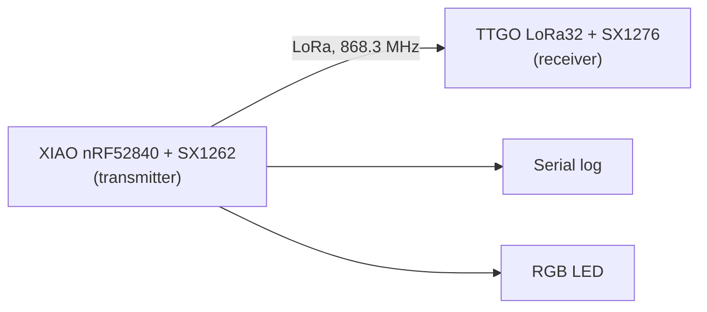

# XIAO nRF52840: LoRa transmitter

A Seeed XIAO nRF52840 example that **sends a LoRa packet every 30 seconds** with an **SX1262** radio module. The radio is driven with the [RadioLib](https://github.com/jgromes/RadioLib) library.

This is one half of a pair. The other half is [05-ttgo-lora-receiver](../05-ttgo-lora-receiver): a TTGO LoRa32 board with an **SX1276** radio that receives the packets and shows them on its OLED.



The two boards use **different radio chips** (SX1262 and SX1276). They can still talk to each other, because both use the same LoRa modulation and the same settings.

## How it works

1. `setup()` sets the TCXO voltage, then starts the radio with the LoRa settings from [include/lora.h](include/lora.h). The green LED turns on when the radio is ready.
2. Every 30 seconds `loop()` builds a text message and starts sending it with `startTransmit()`. This call does not wait: the radio sends the packet in the background. The red LED turns on.
3. When the packet is sent, the radio raises the **DIO1** pin. RadioLib calls the `setFlag()` interrupt handler, which only sets the `transmittedFlag` flag.
4. `loop()` sees the flag, logs the result, calls `finishTransmit()` to turn the transmitter off, and turns the red LED off.

The first packet is sent right after start-up, and the next ones every 30 seconds after that.

### The message

```
Package #3 at 63s, T=27.5
```

| Part | Meaning |
|---|---|
| `#3` | Packet number, counted from 1 |
| `63s` | Transmitter uptime in seconds (`millis() / 1000`) |
| `T=27.5` | nRF52840 CPU temperature in °C, from `readCPUTemperature()` |

### LEDs

The XIAO RGB LED is **active `LOW`**: `LOW` turns a color on, `HIGH` turns it off.

| LED | Meaning |
|---|---|
| Green on | Radio init succeeded |
| Red on | A packet is being sent |

## Radio settings

Both boards must use the **same** LoRa settings, or the receiver will not see the packets. The transmitter keeps them in [include/lora.h](include/lora.h), and the receiver keeps them in its own `include/lora.h`.

| Setting | Value | Notes |
|---|---|---|
| Frequency | **868.3 MHz** | EU 868 band |
| Bandwidth | **250 kHz** | |
| Spreading factor | **7** | Lower = faster, shorter range |
| Coding rate | **4/5** | |
| Sync word | **0x22** | Private network, so it ignores other LoRa traffic |
| Preamble | **8** symbols | |
| Output power | **14 dBm** | Transmitter only, does not need to match |
| TCXO voltage | **1.6 V** | SX1262 only, see below |

**TCXO:** most SX1262 modules use a temperature-compensated crystal (TCXO) that the radio powers itself. RadioLib must know its voltage **before** `begin()`, so the code sets `radio.tcxoVoltage` first. If your module has a plain crystal (XTAL), set `LORA_TCXO_VOLTAGE` to `0`. If this value is wrong, `begin()` usually fails.

Current settings was tested within ~23 meters and 1 wall between.

### Measurements of different LoRa settings

| SF | BW | Package | Time |
|---|---|---|---|
| SF6 | 125 kHz | 64B | 67.4ms |
| SF6 | 500 kHz | 64B | 16.6ms |
| SF12 | 125 kHz | 64B | 2793ms |
| SF12 | 500 kHz | 64B | 616ms |

Lower SF value provides much faster transfer (but range is lower too).  
Higher BW provides much faster transfer (but error rate also grows).

### Comparison with FSK

LoRa is the default. To send with FSK instead, uncomment `-D RADIO_MODEM_FSK` in [platformio.ini](platformio.ini). The FSK settings are in [include/fsk.h](include/fsk.h).

| Modulation | Params | Package | Time |
|---|---|---|---|
| FSK | bitrate / f_dev: 15200 | 64B | 38ms |
| FSK | bitrate / f_dev: 100000 | 64B | 5.7ms |

## Pins

| SX1262 signal | XIAO pin | Notes |
|---|---|---|
| **SCK** | D8 | Default XIAO SPI pins |
| **MISO** | D9 | |
| **MOSI** | D10 | |
| **NSS** (chip select) | D4 | |
| **DIO1** (packet done interrupt) | D1 | SX126x uses DIO1, not DIO0 |
| **RESET** | D2 | |
| **BUSY** | D3 | SX126x only: radio is busy, wait before the next command |
| **RF switch** | D5 | Switches the antenna between transmit and receive |

| LED | Pin |
|---|---|
| Red | 11 |
| Blue | 12 |
| Green | 13 |

RadioLib uses the default `SPI` object, so `SCK_PIN`, `MISO_PIN` and `MOSI_PIN` in [include/config.h](include/config.h) are only for reference. Pin assignments are defined in [include/config.h](include/config.h).

> **Always connect the antenna before you power the board.** The SX1262 can be damaged if it transmits without an antenna.

## Code structure

| Path | What it does |
|---|---|
| [src/main.cpp](src/main.cpp) | `setup()`: radio init. `loop()`: send a packet every 30 s and finish it when done |
| [include/config.h](include/config.h) | Pin assignments (radio and LEDs) |
| [include/lora.h](include/lora.h) | LoRa radio settings (must match the receiver) and the TCXO voltage |
| [include/fsk.h](include/fsk.h) | FSK radio settings, used with `-D RADIO_MODEM_FSK` |

## Build and run

```sh
pio run -t upload
pio device monitor
```

The board uses the Seeed platform from GitHub (see [platformio.ini](platformio.ini)), so the first build downloads it and takes longer.

### Build flags

Set these in `build_flags` in [platformio.ini](platformio.ini). PlatformIO rebuilds the project when they change.

| Flag | Default | What it does |
|---|---|---|
| `LOG_LEVEL` | none, must be set | ArduinoLog level, for example `LOG_LEVEL_VERBOSE` to see every packet |
| `LORA_FIXED_PAYLOAD_SIZE` | `0` | `1`..`255`: every packet is exactly this many bytes. The text is padded with `0xAA`, or cut if it is longer. `0`: the packet is only as long as the text |
| `RADIO_MODEM_FSK` | not set (LoRa) | If set, the radio uses FSK with the settings from [include/fsk.h](include/fsk.h) instead of LoRa |

For example, to send 64-byte FSK packets:

```ini
build_flags =
	-D LOG_LEVEL=LOG_LEVEL_VERBOSE
	-D LORA_FIXED_PAYLOAD_SIZE=64
	-D RADIO_MODEM_FSK
	-Wall
```

> The receiver in [05-ttgo-lora-receiver](../05-ttgo-lora-receiver) only listens for LoRa, so it does not see FSK packets.

The serial monitor runs at 115200 baud. With `LOG_LEVEL_VERBOSE` each packet looks like this:

```
[SX1262] Sending packet #3...
[SX1262]   transmission finished!
```

To see the packets arrive, flash and start the receiver from [05-ttgo-lora-receiver](../05-ttgo-lora-receiver).
