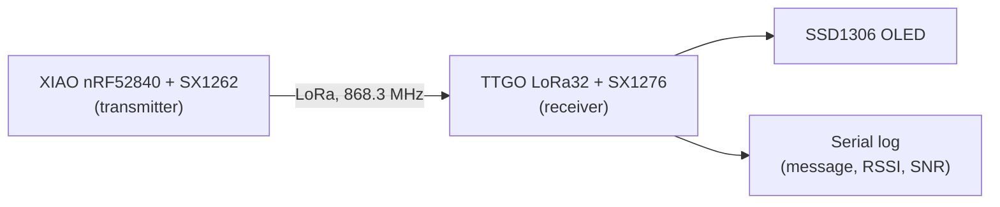

# TTGO LoRa32: LoRa receiver

A TTGO LoRa32 example that **receives LoRa packets** with the onboard **SX1276** radio and shows each message on the onboard SSD1306 OLED. The radio is driven with the [RadioLib](https://github.com/jgromes/RadioLib) library.

This is one half of a pair. The other half is [05-nrf-lora-transmitter](../05-nrf-lora-transmitter): a Seeed XIAO nRF52840 board with an **SX1262** radio that sends a packet every 30 seconds.



## How it works

1. `setup()` starts SPI, the OLED and the radio with the LoRa settings from [include/lora.h](include/lora.h).
2. The radio goes into **receive mode** with `startReceive()`. The OLED shows `Listening LoRa...`.
3. When a full packet arrives, the radio raises the **DIO0** pin. RadioLib calls the `setFlag()` interrupt handler, which only sets the `receivedFlag` flag.
4. `loop()` sees the flag, reads the packet with `readData()` and:
   - prints the message on the OLED,
   - writes the message, **RSSI** (signal strength) and **SNR** (signal-to-noise ratio) to the serial log.
5. If the packet is broken (for example, a CRC error), the OLED shows `Packet receiving failed!` and the log shows the error code.

The interrupt handler does no real work. All slow work (SPI reads, OLED updates, logging) happens in `loop()`.

## Radio settings

Both boards must use the **same** LoRa settings, or the receiver will not see the packets. The receiver keeps them in [include/lora.h](include/lora.h), the transmitter keeps them in its own `include/lora.h`.

| Setting | Value | Notes |
|---|---|---|
| Frequency | **868.3 MHz** | EU 868 band |
| Bandwidth | **250 kHz** | |
| Spreading factor | **7** | Lower = faster, shorter range |
| Coding rate | **4/5** | |
| Sync word | **0x22** | Private network, so it ignores other LoRa traffic |
| Preamble | **8** symbols | |

Output power is different on each side (10 dBm on the SX1276, 14 dBm on the SX1262). It does not need to match.

## Pins

Everything is wired on the TTGO board, so no external wiring is needed. On the transmitter side you only need the antenna.

| Signal | ESP32 pin |
|---|---|
| SX1276 **SCK** | GPIO 5 |
| SX1276 **MISO** | GPIO 19 |
| SX1276 **MOSI** | GPIO 27 |
| SX1276 **NSS** (chip select) | GPIO 18 |
| SX1276 **DIO0** (packet done interrupt) | GPIO 26 |
| SX1276 **RESET** | GPIO 23 |
| OLED **SDA** | GPIO 21 |
| OLED **SCL** | GPIO 22 |

The OLED I2C address is `0x3C`. Pin assignments are defined in [include/config.h](include/config.h).

> **Always connect the antenna before you power the board.** A LoRa radio without an antenna can be damaged when it transmits. The receiver does not transmit, but the transmitter does.

## Code structure

| Path | What it does |
|---|---|
| [src/main.cpp](src/main.cpp) | `setup()`: SPI, OLED and radio init, start receiving. `loop()`: read the packet and show it |
| [include/config.h](include/config.h) | Pin assignments and the OLED I2C address |
| [include/lora.h](include/lora.h) | LoRa radio settings (must match the transmitter) |

## Build and run

Flash the receiver:

```sh
pio run -t upload
pio device monitor
```

Then flash the transmitter from [05-nrf-lora-transmitter](../05-nrf-lora-transmitter) in the same way.

The serial monitor runs at 115200 baud. With `LOG_LEVEL_VERBOSE` (set in [platformio.ini](platformio.ini)) each received packet looks like this:

```
[SX1276] Packet received! RSSI: -45.00dBm / SNR: 9.50 dB
[SX1276]    Message: Package #3 at 60s, T=27.5
```

The message contains the packet number, the transmitter uptime in seconds and the nRF52840 CPU temperature.
