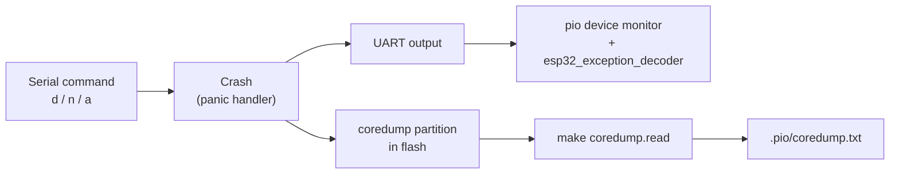

# TTGO LoRa32: crash dump

A TTGO LoRa32 example for **crashing the ESP32 on purpose and finding out why it crashed**. The firmware waits for a command over Serial and then crashes in one of three ways. Each crash can be read in two ways:

- **live**, in the serial monitor, with the backtrace decoded to file and line;
- **after the fact**, from the **core dump** that ESP-IDF saves to flash, even if no monitor was connected when the board crashed.



## Setup

The tools come from the top-level [Makefile](../Makefile). On a new machine, run once from the repo root:

```
make init    # PlatformIO, esptool + esp-coredump, standalone Xtensa GDB
make path    # adds the tools to PATH (run only once)
```

## Build environments

[platformio.ini](platformio.ini) has two environments. The shared settings live in the plain `[env]` section, which every `[env:*]` inherits.

| Environment | `build_type` | ArduinoLog `LOG_LEVEL` | ESP-IDF `CORE_DEBUG_LEVEL` |
|---|---|---|---|
| `ttgo-lora32-v21-dev` (default) | `debug` | `VERBOSE` | `5` (verbose) |
| `ttgo-lora32-v21-prod` | `release` | `WARNING` | `3` (info) |

```
pio run -e ttgo-lora32-v21-dev -t upload
pio device monitor -e ttgo-lora32-v21-dev
```

There are two separate log systems:

- **`log_i()` / `ESP_LOGI()`** come from Arduino-ESP32 / ESP-IDF. `CORE_DEBUG_LEVEL` filters them **at compile time**.
- **`Log.infoln()`** and the like come from the ArduinoLog library. `LOG_LEVEL` filters them.

## Firmware version

[bin/git_version.py](bin/git_version.py) runs before every build (`extra_scripts = pre:...`) and writes `include/version.h`:

```c
#define FW_VERSION "v0.1.0-3-g2b3ca62-dirty"   // git describe --tags --always --dirty
#define GIT_HASH   "2b3ca62"                   // git rev-parse --short HEAD
#define BUILD_TIME "2026-10-26 12:55:05"
#define BUILD_ENV  "ttgo-lora32-v21-dev"
```

The file is rewritten only when its content changes, so a build without changes stays incremental. It is generated, so it is in `.gitignore`.

On start-up the firmware logs the version, the **reset reason** and the free heap:

```
[I][main.cpp:23] setup(): fw 2b3ca62 (2b3ca62) build 2026-10-26 12:55:05
[I][main.cpp:24] setup(): reset reason: 4 (ESP_RST_PANIC)
[I][main.cpp:25] setup(): free heap: 300000
```

[include/reset.h](include/reset.h) turns the `esp_reset_reason()` code into its name. `ESP_RST_PANIC` means the previous run ended in a crash.

## Crash commands

The board does not crash on its own. It waits for one character from the serial monitor. No Enter key is needed. The OLED shows the available commands.

| Key | What it does | `EXCCAUSE` |
|---|---|---|
| `d` | Integer division by zero | `IntegerDivideByZero` (`0x6`) |
| `n` | Reads through a null pointer | `LoadProhibited` (`0x1c`) |
| `a` | Calls `abort()` | see the note below |

The values involved are `volatile`. Without it the compiler can see that the result is unused, or that the code divides by a constant zero (undefined behaviour), and remove the crash entirely.

## Reading a crash live

`monitor_filters = esp32_exception_decoder` decodes the panic output in the monitor:

```
Guru Meditation Error: Core  1 panic'ed (IntegerDivideByZero). Exception was unhandled.
PC      : 0x400d1753 ...
  #0  0x400d1753 in loop() at src/main.cpp:58
Backtrace: 0x400d1750:0x3ffb2270 0x400d6aed:0x3ffb2290
  #0  0x400d1750 in loop() at src/main.cpp:58
  #1  0x400d6aed in loopTask(void*) at .../cores/esp32/main.cpp:50
```

- The **board** prints the register dump and the `Backtrace:` line, but only as raw addresses.
- The **filter**, running on the PC, adds the `#0 ... at file:line` lines. It looks the addresses up in `firmware.elf`, so the monitor must use the **same environment** that was flashed.
- The filter tries to decode every number that looks like an address. Only code addresses (`0x400...`) are meaningful. Lines like `0x3ffc1cc4 in ?? at main.cpp:17` are data pointers in RAM and can be ignored.

## Reading the core dump from flash

ESP-IDF saves a core dump to the `coredump` partition on every panic. It holds the registers, the backtrace and the stacks of all tasks. It stays in flash until it is erased or overwritten by the next crash.

Both things it needs are already in place:

- The board's default partition table (`framework-arduinoespressif32/tools/partitions/default.csv`) has `coredump, data, coredump, 0x3F0000, 0x10000`.
- The precompiled Arduino-ESP32 SDK has `CONFIG_ESP_COREDUMP_ENABLE_TO_FLASH=y` and `CONFIG_ESP_COREDUMP_DATA_FORMAT_ELF=y`.

To read it, **close the serial monitor** (it holds the port) and run:

```
make coredump.read                      # default PORT=/dev/ttyACM1
make coredump.read PORT=/dev/ttyUSB0
```

The [Makefile](Makefile) does two steps:

1. `esptool read-flash` copies the partition into `.pio/coredump.bin`.
2. `esp-coredump info_corefile -t raw` decodes it into `.pio/coredump.txt`.

To decode a single address, for example from a `Backtrace:` line:

```
make backtrace.explain ADDR=0x400d1946
```

### Why it is done this way

- **`esp-coredump --port ...` does not work without ESP-IDF.** When it reads straight from the board, it needs `IDF_PATH` and stops with `Please set up ESP-IDF`. When it is given a file (`-c`), ESP-IDF is not needed. That is why the flash is read with `esptool` first.
- **The GDB from `toolchain-xtensa-esp32` does not start.** It is linked against `libpython2.7`, which modern distros no longer have. `esp-coredump` then just exits with `Error 1` and no message. The Makefile uses the standalone `tool-xtensa-esp-elf-gdb` package instead, which `make init` installs.
- **Partition offset and size** are Makefile variables (`COREDUMP_OFFSET`, `COREDUMP_SIZE`). They must change if the partition table changes.

### How to read `coredump.txt`

Most of the report is only needed for hard cases. Read it in this order:

1. **`Crashed task handle ... name: 'loopTask'`**: which task crashed. `loopTask` is the task that runs `setup()` and `loop()`.
2. **`CURRENT THREAD STACK`**: the call chain, read **bottom to top**. The first frame in `src/` is where your code went wrong. Frames from `/home/runner/work/esp32-arduino-lib-builder/...` are inside the precompiled SDK.
   ```
   #0 panic_abort()   ...
   #1 esp_system_abort()
   #2 abort()
   #3 loop()          at src/main.cpp:72   ← here
   #4 loopTask()      at cores/esp32/main.cpp:50
   ```
3. **`exccause` / `excvaddr`**: the CPU exception and the bad address. If `excvaddr` is `0x0` or a small number, the code used a null pointer.
4. **Task table, `STACK USED/FREE`**: if the crashed task has almost no free stack, the real cause is probably a **stack overflow**, not the line in the backtrace.

**Note on `abort()`:** after `a`, the report shows `exccause = StoreProhibited` and `excvaddr = 0x0`. This is **not** the cause. `panic_abort()` writes to address `0` on purpose to trigger the panic handler. For `abort()`, the real reason is the text `abort() was called at PC ...` in the stack.

## Code structure

| Path | What it does |
|---|---|
| [src/main.cpp](src/main.cpp) | Start-up log (version, reset reason, heap), OLED hint, crash commands in `loop()` |
| [include/reset.h](include/reset.h) | `getEspReasonName()`: reset reason code to name |
| [include/config.h](include/config.h) | Pin assignments and the OLED I2C address |
| [bin/git_version.py](bin/git_version.py) | Pre-build script that generates `include/version.h` |
| [platformio.ini](platformio.ini) | `dev` / `prod` environments, exception decoder, version script |
| [Makefile](Makefile) | `coredump.read`, `backtrace.explain` |
