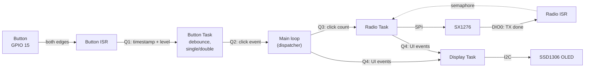

# TTGO LoRa32: FreeRTOS basics

A TTGO LoRa32 example that splits the work into **FreeRTOS tasks** connected by **queues**. A button press is classified as a **single** or **double** click, and each type sends its own LoRa packet through the onboard **SX1276** radio.

> **Status:** all tasks work end to end. The software latency measurement is still to do. See [SPEC.md](SPEC.md) for the detailed design.

## The task

> Create a program with:
>
> - a **main loop** that receives button results from a queue and starts sending the matching radio message;
> - a separate **button task** that detects the press type (**single** or **double**) and puts the result into a queue;
> - a separate **radio task** that sends the radio messages.
>
> Flow: `Button → Button Task → Queue → Main Loop → Radio Task → radio message`
>
> Do not put all the logic into `loop()`. Pay attention to task creation, queues, task priorities, no unnecessary blocking, and correct event passing between tasks.
>
> **⭐ Extra:** measure the time from the button press to the radio message being sent, and describe where the delay comes from.

## How it works



1. The **button ISR** only puts the edge timestamp and the pin level into a queue.
2. The **button task** filters out contact bounce and waits a 350 ms window for a second click. It sends `SINGLE` or `DOUBLE` to the main loop. A double click is sent at the second press, without waiting for the window to end.
3. The **main loop** reports the click to the display, maps it to a click count and passes it to the radio queue. If the queue stays full for 1 s, the command is dropped and logged.
4. The **radio task** starts the transmission and sleeps on a semaphore until the radio raises **DIO0** (transmission done), with a timeout of the time on air + 20 ms. Then it turns the transmitter off and reports "sent" or "failed" to the display.
5. The **display task** owns the I2C bus and the OLED. It keeps the counters of single clicks, double clicks, sent and failed packets, and redraws once per burst of events. Its priority is below the button and radio tasks, so it does not slow down the button → radio path. Events are posted without waiting: if its queue is full, the event is dropped and counted.

No task polls flags or uses `delay()` to wait for events: every task sleeps on a queue or a semaphore.

### Messages

| Click | Radio packet |
|---|---|
| Single | `SINGLE CLICK` |
| Double | `DOUBLE CLICK` |

## Pins

The radio and the OLED are wired on the board. The button and the debug pins are external.

| Signal | ESP32 pin | Notes |
|---|---|---|
| Radio **SCK** | GPIO 5 | onboard |
| Radio **MISO** | GPIO 19 | onboard |
| Radio **MOSI** | GPIO 27 | onboard |
| Radio **NSS** (CS) | GPIO 18 | onboard |
| Radio **RST** | GPIO 23 | onboard |
| Radio **DIO0** | GPIO 26 | onboard, "TX done" interrupt |
| OLED **SDA** | GPIO 21 | onboard, I2C address `0x3C` |
| OLED **SCL** | GPIO 22 | onboard |
| LED | GPIO 25 | onboard |
| **Button** | GPIO 15 | to GND, internal pull-up. Strapping pin: held at boot, it silences the UART boot log |
| Debug 1 | GPIO 13 | logic analyzer marker: HIGH on a button edge, LOW when the click is sent to the main loop |
| Debug 2 | GPIO 14 | logic analyzer marker: HIGH while the radio transmits. Short PWM at boot |

Pin assignments are defined in [include/config.h](include/config.h), LoRa settings in [include/lora.h](include/lora.h).

## Code structure

| Path | What it does |
|---|---|
| [src/main.cpp](src/main.cpp) | `setup()`: starts the display, the button and the radio; `loop()`: click → display and radio dispatcher |
| [src/button.cpp](src/button.cpp) | Button ISR and button task (debounce, single/double detection), Q1 and Q2 |
| [src/radio.cpp](src/radio.cpp) | Radio init, DIO0 ISR, radio task and Q3 |
| [src/display.cpp](src/display.cpp) | Display task, Q4, I2C and OLED init, counters on the OLED. Public API in [include/display.h](include/display.h): `begin()`, `post()` |
| [include/config.h](include/config.h) | Pin assignments |
| [include/lora.h](include/lora.h) | LoRa radio settings |

## Latency measurement ⭐

The press → send delay is measured with a logic analyzer (button line, debug markers and DIO0) and in software (the ISR timestamp travels with the event down to the radio task). The method is described in [SPEC.md](SPEC.md#latency-measurement-).

First results from the logic analyzer (SF7, BW 250 kHz, 12-byte packet):

| Part of the delay | Measured |
|---|---|
| Waiting for a possible second click, `SINGLE` only | ≈ 350 ms, by design |
| Click classified → transmission started | a few ms |
| Time on air (start → DIO0) | ≈ 21 ms, 20.6 ms by the LoRa formula |

So a `SINGLE` click reaches the air in ≈ 375 ms, and almost all of that is the double-click window. A `DOUBLE` click takes ≈ 25 ms after the second press. The software measurement is _TBD_.

## Build and run

```sh
pio run -t upload
pio device monitor
```

The serial monitor runs at 115200 baud. Logs use the ESP-IDF `log_*` macros, the level is set by `CORE_DEBUG_LEVEL` in [platformio.ini](platformio.ini) (4 = debug, 5 = verbose, needed for the raw button edges).
