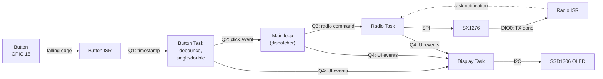

# TTGO LoRa32: FreeRTOS basics

A TTGO LoRa32 example that splits the work into **FreeRTOS tasks** connected by **queues**. A button press is classified as a **single** or **double** click, and each type sends its own LoRa packet through the onboard **SX1276** radio.

> **Status:** work in progress. The architecture below is a draft; see [SPEC.md](SPEC.md) for the detailed design.

## The task

> Create a program with:
>
> - a **main loop** that receives button results from a queue and starts sending the matching radio message;
> - a separate **button task** that detects the press type (**single** or **double**) and puts the result into a queue;
> - a separate **radio task** that sends the radio messages.
>
> Flow: `Button → Button Task → Queue → Main Loop → Radio Task → radio message`
>
> Do not put all the logic into `loop()`. Pay attention to task creation, queues, task priorities, no unnecessary blocking, and correct event passing between tasks.
>
> **⭐ Extra:** measure the time from the button press to the radio message being sent, and describe where the delay comes from.

## How it works



1. The **button ISR** only puts the press timestamp into a queue.
2. The **button task** filters out contact bounce and waits a short window for a second click. It sends `SINGLE` or `DOUBLE` to the main loop.
3. The **main loop** maps the click to a radio command and passes it on. If the radio queue is full, the command is dropped and an error is shown.
4. The **radio task** starts the transmission and sleeps until the radio raises **DIO0** (transmission done), then turns the transmitter off.
5. The **display task** keeps the counters and errors and draws them on the OLED. It has the lowest priority, so it does not slow down the button → radio path.

No task polls flags or uses `delay()` to wait for events: every task sleeps on a queue or a notification.

### Messages

| Click | Radio packet |
|---|---|
| Single | `BUTTON SINGLE` |
| Double | `BUTTON DOUBLE` |

## Pins

The radio and the OLED are wired on the board. The button and the debug pins are external.

| Signal | ESP32 pin | Notes |
|---|---|---|
| Radio **SCK** | GPIO 5 | onboard |
| Radio **MISO** | GPIO 19 | onboard |
| Radio **MOSI** | GPIO 27 | onboard |
| Radio **NSS** (CS) | GPIO 18 | onboard |
| Radio **RST** | GPIO 23 | onboard |
| Radio **DIO0** | GPIO 26 | onboard, "TX done" interrupt |
| OLED **SDA** | GPIO 21 | onboard, I2C address `0x3C` |
| OLED **SCL** | GPIO 22 | onboard |
| LED | GPIO 25 | onboard |
| **Button** | GPIO 15 | to GND, internal pull-up. Strapping pin: held at boot, it silences the UART boot log |
| Debug 1 | GPIO 13 | logic analyzer marker |
| Debug 2 | GPIO 14 | logic analyzer marker, short PWM at boot |

Pin assignments are defined in [include/config.h](include/config.h), LoRa settings in [include/lora.h](include/lora.h).

## Code structure (planned)

| Path | What it does |
|---|---|
| [src/main.cpp](src/main.cpp) | `setup()`: creates queues and tasks; `loop()`: click → radio command dispatcher |
| [src/button.cpp](src/button.cpp) | Button ISR and button task (debounce, single/double detection) |
| [src/radio.cpp](src/radio.cpp) | Radio init, DIO0 ISR and radio task |
| `src/display.cpp` | Display task: counters and errors on the OLED |
| [include/config.h](include/config.h) | Pin assignments |
| [include/lora.h](include/lora.h) | LoRa radio settings |

## Latency measurement ⭐

The press → send delay is measured with a logic analyzer (button line, debug markers and DIO0) and in software (the ISR timestamp travels with the event down to the radio task). The method is described in [SPEC.md](SPEC.md#latency-measurement-).

Results: _TBD_.

## Build and run

```sh
pio run -t upload
pio device monitor
```

The serial monitor runs at 115200 baud.
