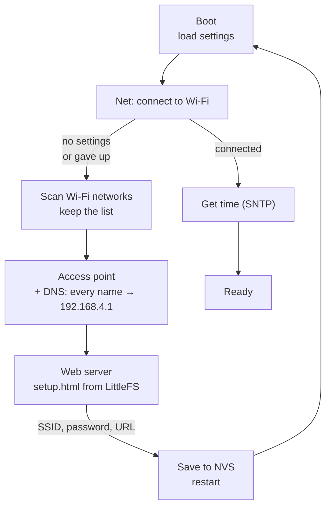
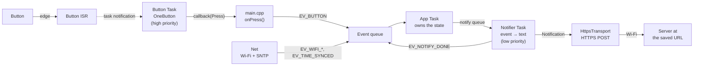
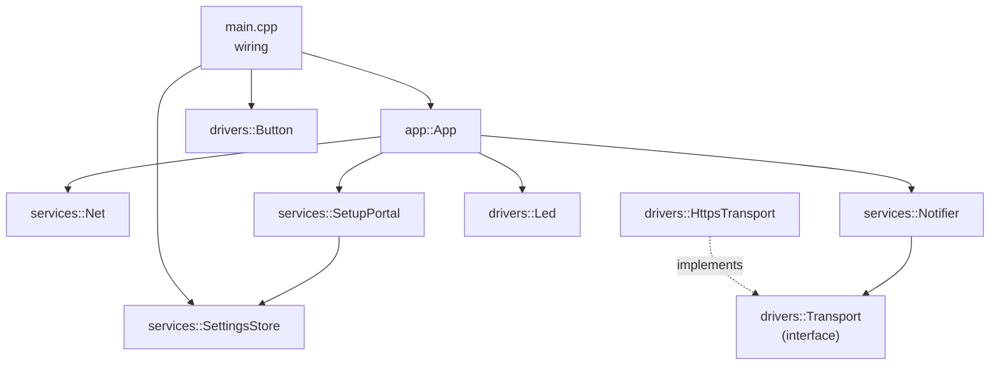

# TTGO LoRa32: Wi-Fi basics

A TTGO LoRa32 example that connects the ESP32 to **Wi-Fi** and sends a **notification over HTTPS** when a button is pressed. On the first start there are no saved settings, so the board opens its own access point with a **captive portal**: a phone that joins it is taken to the settings page automatically.

> **Status:** concept and architecture. No code yet. The architecture follows the lecture summary in [ARCH_GUIDE.md](ARCH_GUIDE.md); the decisions for this project are below.

## The idea

- On start-up the board reads the Wi-Fi settings from **NVS**.
- **No settings** / **Unable to connect** → the board starts an **access point** (AP). A phone connects to it, and the OS opens the **settings page** by itself (captive portal). The page asks for:
  - the Wi-Fi network, picked from a list of the networks around (scanned before the AP starts), and the password;
  - the **URL** where notifications are sent.

  The settings are saved to NVS, and the board restarts in station mode.
- **Settings found** → the board connects to the Wi-Fi network (station mode, STA), gets the **time over SNTP** and starts listening to the button.
- **Button pressed** → the board sends a text notification with the press time to the saved URL.
- **The LED shows the mode**: blinking while connecting, double blink + pause in the setup portal, steady on when ready.

The HTML of the settings page lives in a **flash file system** (LittleFS), not in C++ strings.

Nothing blocks: every part runs in its own **FreeRTOS task**, and tasks talk to each other through **queues**. The button path has a higher priority than the network path, so a slow HTTPS request never delays a press.

## How it works



Once the board is online:



### Captive portal

A phone checks for internet access right after joining a network by requesting a known URL (Android `/generate_204`, iOS `/hotspot-detect.html`, Windows `/connecttest.txt`). The board answers every DNS query with its own address and every unknown HTTP path with a redirect to the settings page. The phone sees an unexpected answer and opens the page in its portal browser.

The portal uses the synchronous **`WebServer`** and **`DNSServer`** from the Arduino core. Both are polled: one low-priority portal task calls `handleClient()` and `processNextRequest()` every 5 ms. It only runs in `PROVISIONING`, when there is nothing else to do, so the polling costs nothing. `WebServer` serves one client at a time: the parallel requests of a phone wait in line.

**Network list.** The board scans for networks **once, before it starts the AP**, and keeps the list. Scanning while the AP is up makes the radio leave the AP channel, and a connected phone can drop. The list is deduplicated by SSID, sorted by signal strength and limited to the strongest networks. Hidden networks need a manual SSID field.

**Page and data are separate.** `setup.html` is a static file, streamed from LittleFS as is (`streamFile()`, no templating on the board). The list comes from a separate endpoint, and JavaScript on the page builds the `<select>`:

| Request | Answer |
|---|---|
| `GET /` | `setup.html` from LittleFS |
| `GET /networks.json` | `[{"ssid": "...", "rssi": -52, "secure": true}, ...]` |
| `POST /save` | SSID, password, URL → validated → NVS, then `EV_CONFIG_SAVED` |
| anything else | redirect to `/` (captive portal) |

SSIDs come from any device nearby, so they are untrusted. The board escapes them as JSON strings (quotes, `\`, control characters), and the page puts them into the DOM with `textContent`, never `innerHTML`, so an SSID like `<script>` stays plain text.

`POST /save` checks the values before writing: the SSID is not empty and the URL starts with `https://`. On an error the page shows it, and nothing is written.

The portal itself is plain HTTP: there is no valid certificate for `192.168.4.1`, and the phone's captive portal check works over HTTP anyway.

### Button

The press types (single, double, long) come from the **OneButton** library, but the button is not polled while idle:

1. The **button ISR** only wakes the button task with a **task notification** (`vTaskNotifyGiveFromISR`).
2. The **button task** sleeps in `ulTaskNotifyTake` until an edge arrives. Then it calls `tick()` every 10 ms until `isIdle()` returns `true`, and goes back to sleep.
3. OneButton callbacks run in the button task. The driver turns them into one callback of its own, `void (*)(Press, void* ctx)`, with `Press` = `Single` / `Double` / `Long`.

Contact bounce only fires the ISR again: the notification saturates, and OneButton does the debouncing. The task must exist before `attachInterrupt()`, otherwise the ISR gets a `NULL` task handle.

**The driver knows no events and no queues.** It only binds the hardware: pin, ISR, task, click types. OneButton is an implementation detail: its types never leave the driver. A plain function in `main.cpp` turns a press into an event:

```cpp
// main.cpp
static void onPress(drivers::Button::Press p, void* ctx) {
    auto q = static_cast<QueueHandle_t>(ctx);
    event_t e{ EV_BUTTON, millis(), static_cast<int32_t>(p) };
    xQueueSend(q, &e, 0);
}
static drivers::Button button(BTN_PIN, onPress, events);
```

The callback runs in the button task, so it must be short: no waiting, `xQueueSend` with timeout 0.

OneButton takes a plain function plus a `void*`, not a class method: a method needs `this`, so its pointer has a different type. The driver passes a static "thunk" function and `this` as the `void*`, and the thunk calls the method. The driver's own callback uses the same `void* ctx` pattern.

### LED

The LED is the only UI: it shows the current mode.

| Mode | Pattern | Looks like |
|---|---|---|
| `CONNECTING` (start, or after `EV_WIFI_DOWN`) | `Blink` | 250 ms on, 250 ms off |
| `PROVISIONING` | `DoubleBlink` | on 100, off 150, on 100, off 900 ms |
| `ONLINE`, time synced | `On` | steady on |

`drivers::Led` is the mirror of `Button`: it knows patterns (`Off`, `On`, `Blink`, `DoubleBlink`), not modes. `App` owns the mode, so `App` picks the pattern. The LED turns on only after `EV_TIME_SYNCED`, not at `EV_WIFI_UP`: until the time is known, a press cannot be sent with a correct timestamp.

**A pattern is data**: a list of steps `{level, ms}`. `ms = 0` means "hold until the next pattern".

```cpp
struct Step { bool on; uint16_t ms; };
static const Step BLINK[]  = {{true, 250}, {false, 250}};
static const Step DOUBLE[] = {{true, 100}, {false, 150}, {true, 100}, {false, 900}};
static const Step ON[]     = {{true, 0}};
static const Step OFF[]    = {{false, 0}};
```

**One task, never deleted. The wait is the delay.** The LED task sets the level of the current step and then waits for its task notification, with the step duration as the timeout:

- timeout → the step is over, go to the next one;
- notification → a new pattern, switch at once and start from step 0.

`play()` sends the pattern number in the notification value (`xTaskNotify(..., eSetValueWithOverwrite)`) and returns at once: no queue, no shared variable, the latest call wins.

```cpp
void Led::play(Pattern p) {
    xTaskNotify(_task, static_cast<uint32_t>(p), eSetValueWithOverwrite);
}

void Led::run() {
    Pattern p = Pattern::Off;
    size_t i = 0;
    for (;;) {
        const Step& s = steps(p)[i];
        digitalWrite(_pin, s.on);
        TickType_t wait = s.ms ? pdMS_TO_TICKS(s.ms) : portMAX_DELAY;
        uint32_t v;
        if (xTaskNotifyWait(0, 0, &v, wait) == pdTRUE) { p = static_cast<Pattern>(v); i = 0; }
        else                                          { i = (i + 1) % count(p); }
    }
}
```

Why not the alternatives:

- **`vTaskDelay` + check a flag at the end of the cycle**: the switch comes up to one full cycle late (1.3 s for `DoubleBlink`).
- **Delete the task and create a new one per pattern**: a race when `play()` comes during the delete, the LED can stay on in the middle of a blink, and every switch allocates a new stack.

`On` and `Off` cost nothing: the task waits with `portMAX_DELAY` and only wakes on the next `play()`. Task notifications belong to one task, so the LED task's notification does not clash with the button task's.

The task must exist before the first `play()`, otherwise `_task` is `NULL` (the same rule as `Button` and `attachInterrupt()`).

### Notification

Two questions, two owners:

- **What to say** belongs to the **`Notifier`** service. It turns an event into a human text (`EV_BUTTON` + double click → "Button pressed twice") and converts the press time to wall-clock time.
- **How to deliver** belongs to the **transport**. `HttpsTransport` sends the text in an HTTPS POST body. Tomorrow a `BleTransport` can send the same `Notification` its own way.

```cpp
struct Notification {
    char   text[96];    // what to say; a longer text is sent as several notifications
    time_t epoch;       // when it happened, already wall-clock time
};
```

The text is a fixed buffer, not a `String`: the structure stays safe to copy byte by byte, for example through a queue.

The event carries the **monotonic** press time (`millis()`), because the ISR has no real time. The notifier converts it: current epoch − (`now_ms` − `t_ms`).

**HTTPS.** The board is the client, so it needs no certificate of its own, only a way to check the server's one. The prototype uses `setInsecure()`: the traffic is encrypted, but the server is not verified. A TLS handshake needs about 40–50 KB of heap and takes 1–2 s, so the notifier task gets a larger stack (8–10 KB).

For testing, [ntfy.sh](https://ntfy.sh) takes an HTTPS POST with plain text in the body and shows it as a push on the phone: `https://ntfy.sh/<random-topic>`.

If the network is down, the event stays in the queue, or is dropped and counted when the queue is full.

## Architecture

The architecture follows [ARCH_GUIDE.md](ARCH_GUIDE.md): three layers and one rule, **dependencies only go down**.



| Layer | Knows | Does not know |
|---|---|---|
| **Drivers** | pins, edges, clicks; bytes on the wire, HTTPS | what the product is, what a press means |
| **Services** | NVS keys, Wi-Fi, retries, the text of a notification | which pin the button is on, how the text travels |
| **App** | modes, what to do on a press | registers, HTTP, NVS |

The Arduino libraries (`WiFi`, `Preferences`, `LittleFS`, `HTTPClient`, `OneButton`) already play the role of low-level drivers. `drivers/` only holds what we wrap ourselves.

### Code style

- **One namespace per layer**: `drivers::`, `services::`, `app::`. A `services::` name inside `drivers/` is a wrong-way dependency.
- **One class per file**, files in `snake_case`: `services::SettingsStore` lives in `settings_store.h/.cpp`.
- Private members use the `_name` prefix (Arduino style).

### Modules

| Class | Layer | Does | Task |
|---|---|---|---|
| `drivers::Button` | drivers | ISR → task notification → OneButton → callback `(Press, ctx)` | own, priority 5 |
| `drivers::Led` | drivers | pattern player: steps `{level, ms}`, `play(Pattern)` switches by task notification | own, priority 1 |
| `drivers::Transport` | drivers | interface: `bool send(const Notification&)` | — |
| `drivers::HttpsTransport` | drivers | implements `Transport`: `WiFiClientSecure` + `HTTPClient`, POST to the URL | runs in the notifier task |
| `services::SettingsStore` | services | NVS (`Preferences`): load, save, clear; validates the values | — |
| `services::SetupPortal` | services | scan → AP → DNS + `WebServer`; on save validates, writes through `SettingsStore`, posts `EV_CONFIG_SAVED` | own, priority 1, only in `PROVISIONING` |
| `services::Net` | services | STA connect; **counts the retries itself**; `EV_WIFI_UP` / `EV_WIFI_DOWN` / `EV_WIFI_FAILED`; SNTP → `EV_TIME_SYNCED` | none: `WiFi.onEvent()` callbacks + a retry timer |
| `services::Notifier` | services | event → text + wall-clock time → `Transport::send()` → `EV_NOTIFY_DONE` | own, priority 2 |
| `app::App` | app | owns the state, reacts to events, calls the services | own, priority 4 |

### Settings are passed, not global

`main.cpp` loads the settings **once** and gives each module **only the part it needs**, through its constructor. After the settings are saved the board restarts, so they never change at run time: no global variable, no locking, and every dependency is visible in a constructor.

```cpp
// main.cpp — the only place that sees the whole settings
static services::SettingsStore store;
static Settings settings = store.load();

static drivers::HttpsTransport transport(settings.url);
static services::Notifier      notifier(transport);       // needs no settings
static services::Net           net(settings.wifi);        // SSID + password, may be empty
static services::SetupPortal   portal(store);             // writes through the store
```

`Net` decides by itself: empty credentials → `EV_WIFI_FAILED` at once, so `App` does not need to know whether settings exist.

### One owner of the state

Only **`app::App`** changes the device state, and only in reaction to an event from the event queue. Everyone else posts events and does not know who listens.

| Mode | Event | → Mode | Action |
|---|---|---|---|
| start | — | `CONNECTING` | `net.connect()`, `led.play(Blink)` |
| `CONNECTING` | `EV_WIFI_UP` | `ONLINE` | — |
| `CONNECTING` | `EV_WIFI_FAILED` | `PROVISIONING` | `portal.start()`, `led.play(DoubleBlink)` |
| `ONLINE` | `EV_TIME_SYNCED` | `ONLINE` | `led.play(On)` |
| `ONLINE` | `EV_WIFI_DOWN` | `CONNECTING` | `led.play(Blink)` (`Net` reconnects by itself) |
| `ONLINE` | `EV_BUTTON` | `ONLINE` | `notifier.send(event)` |
| `PROVISIONING` | `EV_CONFIG_SAVED` | — | restart |
| not `ONLINE` | `EV_BUTTON` | unchanged | log "ignored" |

`App` is written as one class first. Later it can be split into a pure `(mode, event) → new mode + action` function (tested on the host) and a thin FreeRTOS wrapper.

### Events

One structure for every source, copied into the queue by value (see [include/event.h](include/event.h)):

```cpp
struct event_t {
    ev_type_t type;
    uint32_t  t_ms;    // when it happened, monotonic (millis())
    int32_t   value;   // meaning depends on the type
};
```

| Event | Source | `value` |
|---|---|---|
| `EV_BUTTON` | `onPress()` in `main.cpp`, from `Button` | `Button::Press`: single / double / long |
| `EV_WIFI_UP` | `Net` | — |
| `EV_WIFI_DOWN` | `Net` | disconnect reason |
| `EV_WIFI_FAILED` | `Net` | — (no settings, or gave up connecting) |
| `EV_TIME_SYNCED` | `Net` | — |
| `EV_CONFIG_SAVED` | `SetupPortal` | — |
| `EV_NOTIFY_DONE` | `Notifier` | HTTP status code, or a negative error |

### Tasks

The priorities are a first proposal. The user tasks run on core 1, because core 0 belongs to the Wi-Fi stack.

| Task | Priority | Waits on |
|---|---|---|
| Button | 5 | task notification from the ISR |
| App | 4 | event queue |
| Notifier | 2 | notify queue |
| Portal | 1 | polls `WebServer` + `DNSServer` every 5 ms, only in `PROVISIONING` |
| LED | 1 | its task notification, timeout = current step duration (`portMAX_DELAY` for `On` / `Off`) |

The Wi-Fi driver has its own system task (priority ≈ 23, core 0). We do not touch it.

### Deviations from ARCH_GUIDE

| Guide | This project | Why |
|---|---|---|
| The button driver posts `EV_BUTTON` into the event queue itself | `drivers::Button` calls a callback; `main.cpp` turns it into an event | `ev_type_t` is the vocabulary of the whole system. A driver that includes `event.h` changes whenever any event is added, and cannot be reused without it. A service in between would only forward calls, so the translation lives in `main.cpp` until it gets real logic |
| `config.c` service, other modules read the config | `main.cpp` loads the settings once and passes each module only its part | the settings never change at run time (saving restarts the board), and every dependency is visible in a constructor |

## Open questions

- How to reset the settings and get back to the portal, for example by holding the button at boot.
- How the board checks the server certificate: `setInsecure()` for the prototype, a CA bundle later.

## Pins

Only the LED, the button and the debug pins are used. Wi-Fi is inside the ESP32.

| Signal | ESP32 pin | Notes |
|---|---|---|
| LED | GPIO 25 | onboard, status indicator |
| **Button** | GPIO 15 | to GND, internal pull-up. Strapping pin: held at boot, it silences the UART boot log |
| Debug 1 | GPIO 13 | logic analyzer marker, _TBD_ |
| Debug 2 | GPIO 14 | logic analyzer marker, _TBD_. Short PWM at boot |

Pin assignments are defined in [include/config.h](include/config.h).

## Code structure

The folders are the layers. No file in `drivers/` includes `event.h` or knows the word "notification", and no file in `app/` knows NVS keys or HTTP: this can be checked with grep.

```
08-wifi-basics/
├── platformio.ini
├── README.md
├── ARCH_GUIDE.md                 lecture summary, the reference for reviews
├── data/
│   └── setup.html                settings page (Wi-Fi + notify URL) → LittleFS
├── include/
│   ├── config.h                  pins, timings, queue sizes
│   ├── event.h                   event_t, shared by all layers
│   ├── notification.h            Notification, shared by Notifier and transports
│   └── settings.h                Settings: wifi (SSID, password) + url
├── src/
│   ├── main.cpp                  load settings, create queues and objects, wire the layers,
│   │                             callbacks → events (onPress)
│   ├── app/
│   │   └── app.cpp/.h            app::App: state owner, event switch
│   ├── services/
│   │   ├── settings_store.cpp/.h services::SettingsStore
│   │   ├── setup_portal.cpp/.h   services::SetupPortal
│   │   ├── net.cpp/.h            services::Net
│   │   └── notifier.cpp/.h       services::Notifier
│   └── drivers/
│       ├── button.cpp/.h         drivers::Button
│       ├── led.cpp/.h            drivers::Led
│       ├── transport.h           drivers::Transport (interface)
│       └── https_transport.cpp/.h drivers::HttpsTransport
└── test/                         host tests, later
```

## Tests

Planned, not written yet. Tests use **Unity** and run on the host (`env:native`), without the board. PlatformIO does not build `src/` for tests by default, so the native environment turns it on and keeps only the files that compile without Arduino:

```ini
[env:native]
platform = native
test_build_src = true
build_src_filter = -<*> +<app/...>   ; only the Arduino-free files
```

The filter also keeps `main.cpp` out, so its `setup()`/`loop()` do not clash with the test's `main()`. First candidates: the `App` transitions (once split), settings validation, event → text in `Notifier` (with a fake `Transport`).

```sh
pio test -e native
```

## Build and run

```sh
pio run -t uploadfs   # settings page → LittleFS
pio run -t upload
pio device monitor
```

The serial monitor runs at 115200 baud. Logs use the ESP-IDF `log_*` macros, the level is set by `CORE_DEBUG_LEVEL` in [platformio.ini](platformio.ini).
