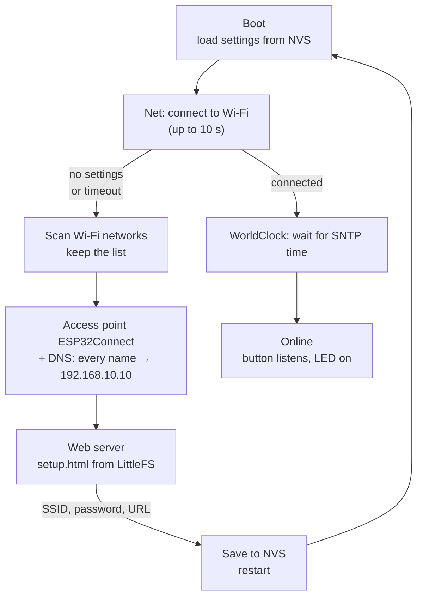
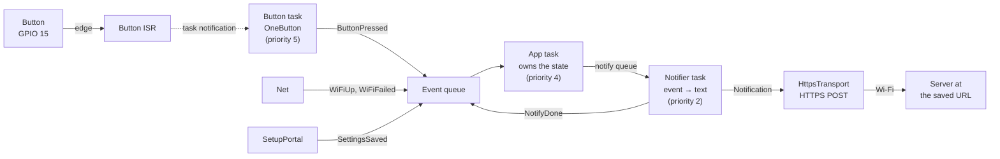
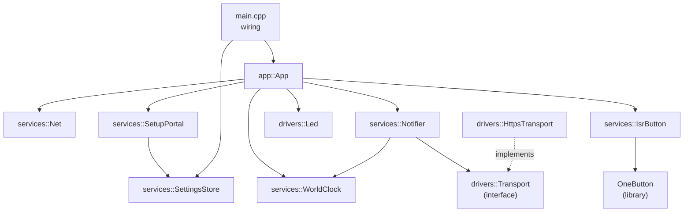

# How it works

The detailed design of the [Wi-Fi captive portal example](README.md): the architecture, the events, the tasks, and why each part is built the way it is. The architecture follows the lecture summary in [ARCH_GUIDE.md](../ARCH_GUIDE.md); the places where this project goes its own way are listed in [Deviations from ARCH_GUIDE](#deviations-from-arch_guide).

## Start-up



Once the board is online:



## Architecture

Three layers and one rule: **dependencies only go down**.



| Layer | Knows | Does not know |
|---|---|---|
| **Drivers** | pins, LED steps; bytes on the wire, HTTPS | what the product is, what a press means |
| **Services** | NVS keys, Wi-Fi, time zone, the text of a notification, which press is which event | how the text travels |
| **App** | modes, what to do on each event | registers, HTTP, NVS |

The Arduino libraries (`WiFi`, `Preferences`, `LittleFS`, `HTTPClient`, `WebServer`, `DNSServer`, `OneButton`) already play the role of low-level drivers. `drivers/` only holds what we wrap ourselves.

### Code style

- **One namespace per layer**: `drivers::`, `services::`, `app::`. A `services::` name inside `drivers/` is a wrong-way dependency.
- **One class per file**, files in `snake_case`: `services::SettingsStore` lives in `settings_store.h/.cpp`.
- Private members use the `_name` prefix (Arduino style).
- A class that runs a FreeRTOS task has a static `xHandle(void*)` (or `...Callback`) that casts the `void*` back to the object and calls a member function.

### Modules

| Class | Layer | Does | Task |
|---|---|---|---|
| `drivers::Led` | drivers | pattern player: steps `{level, ms}`, `play(Pattern)` switches by task notification | own, priority 1 |
| `drivers::Transport` | drivers | interface: `int send(const Notification&)`, returns the HTTP status or a negative error | — |
| `drivers::HttpsTransport` | drivers | implements `Transport`: `WiFiClientSecure` + `HTTPClient`, POST to the URL | runs in the notifier task |
| `services::SettingsStore` | services | NVS (`Preferences`): load, save; falls back to `secrets.h` defaults; validates before writing | — |
| `services::SetupPortal` | services | scan → AP → DNS + `WebServer`; on save validates, writes through `SettingsStore`, posts `SettingsSaved` | own, priority 2, only in provisioning |
| `services::Net` | services | STA connect with a 10 s timeout; posts `WiFiUp` / `WiFiFailed` | none: runs in the App task |
| `services::WorldClock` | services | SNTP + time zone; `millis()` → wall-clock time; formatting | none |
| `services::IsrButton` | services | ISR → task notification → OneButton → `ButtonPressed` event | own, priority 5 |
| `services::Notifier` | services | event → text + wall-clock time → `Transport::send()` → `NotifyDone` | own, priority 2 |
| `app::App` | app | owns the state, reacts to events, calls the services | own, priority 4 |

### Settings are passed, not global

`main.cpp` loads the settings **once** and gives each module **only the part it needs**, through its constructor. After the settings are saved the board restarts, so they never change at run time: no global variable, no locking, and every dependency is visible in a constructor.

```cpp
// main.cpp: the only place that sees the whole settings
static services::SettingsStore settings;
settings.load();

static services::Net net(xEvents, settings.wifi());               // SSID + password, may be empty
static services::SetupPortal setup(xEvents, settings);             // writes through the store
static drivers::HttpsTransport transport(settings.notifications().url);
```

`Net` decides by itself: empty credentials → `WiFiFailed` at once, so `App` does not need to know whether settings exist.

**Development defaults.** `SettingsStore::load()` falls back to `DEFAULT_WIFI_SSID`, `DEFAULT_WIFI_PASS` and `DEFAULT_NOTIFY_URL` from `include/secrets.h` when NVS has nothing. The file is optional (`__has_include`), so a fresh clone builds without it and goes straight to the portal.

## One owner of the state

Only **`app::App`** changes the device state, and only in reaction to an event from the event queue. Everyone else posts events and does not know who listens.

| State | Event | → State | Action |
|---|---|---|---|
| `Loading` | `Initialized` | `Loading` | `net.connect()` (LED already `Blink`) |
| `Loading` | `WiFiFailed` | `Provisioning` | `led.play(DoubleBlink)`, `setup.begin()` |
| `Loading` | `WiFiUp` | `Loading` | `clock.sync()`, then post `TimeSynced` |
| `Loading` | `TimeSynced` | `Online` | `btn.listen()`, `led.play(On)` |
| `Online` | `ButtonPressed` | `Online` | `notifier.send(event)` |
| `Online` | `NotifyDone` | `Online` | log the HTTP status |
| `Provisioning` | `SettingsSaved` | — | `led.play(Blink)`, wait 5 s, restart |

The 5 s wait before the restart gives the phone time to show the "saved" page before the access point disappears.

The button is attached only in `TimeSynced`, so a press can never be sent without a correct timestamp, and the state does not need to be checked on `ButtonPressed`.

## Events

One structure for every source, copied into the queue by value (see [include/event.h](include/event.h)):

```cpp
struct Event {
  EventType_t type;
  uint32_t t_ms;  // when it happened, monotonic (millis())
  int32_t val;    // meaning depends on the type
};
```

`createEvent()` in [include/event_factory.h](include/event_factory.h) fills `t_ms` with the current `millis()`.

| Event | Source | `val` |
|---|---|---|
| `Initialized` | `App::bootstrap()` | — |
| `WiFiUp` | `Net` | — |
| `WiFiDown` | not posted yet (reconnect is a TODO) | — |
| `WiFiFailed` | `Net` | — (no settings, or connect timeout) |
| `TimeSynced` | `App`, after `WorldClock::sync()` returns | — |
| `ButtonPressed` | `IsrButton` | `ButtonEvent_t`: `Single` / `Double` / `Long` |
| `SettingsSaved` | `SetupPortal` | — |
| `NotifyDone` | `Notifier` | HTTP status code, or a negative error |

## Tasks

The user tasks run on core 1, because core 0 belongs to the Wi-Fi stack.

| Task | Priority | Stack | Waits on |
|---|---|---|---|
| Button (`btnTickHandler`) | 5 | 4 KB | task notification from the ISR |
| App (`appQueueHandler`) | 4 | 4 KB | event queue (50 events) |
| Notifier (`notifierHandler`) | 2 | 10 KB | notify queue (10 events) |
| Portal (`setupPortalServerHandler`) | 2 | 8 KB | polls `WebServer` + `DNSServer` every 10 ms, only in provisioning |
| LED (`ledHandler`) | 1 | 2 KB | its task notification, timeout = current step duration |

The Wi-Fi driver has its own system task (priority ≈ 23, core 0). We do not touch it.

`setup()` creates everything and returns; `loop()` only sleeps with `vTaskDelay(portMAX_DELAY)`.

## Captive portal

A phone checks for internet access right after joining a network by requesting a known URL (Android `/generate_204`, iOS `/hotspot-detect.html`, Windows `/connecttest.txt`). The board answers every DNS query with its own address and every unknown HTTP path with a redirect to itself. The phone sees an unexpected answer and opens the page in its portal browser.

The access point is open, named `ESP32Connect`, with the address `192.168.10.10`.

The portal uses the synchronous **`WebServer`** and **`DNSServer`** from the Arduino core. Both are polled: one portal task calls `processNextRequest()` and `handleClient()` every 10 ms. It only runs in provisioning, when there is nothing else to do, so the polling costs nothing. `WebServer` serves one client at a time: the parallel requests of a phone wait in line.

**Network list.** The board scans for networks **once, before it starts the AP**, and keeps the list. Scanning while the AP is up makes the radio leave the AP channel, and a connected phone can drop. Hidden networks are skipped (the page has a manual SSID field), one network with several access points (mesh, office) is kept once with its strongest signal, and the list is sorted by signal strength.

**Page and data are separate.** `setup.html` is a static file, streamed from LittleFS as is (no templating on the board). The list comes from a separate endpoint, and JavaScript on the page builds the `<select>`:

| Request | Answer |
|---|---|
| `GET /` | redirect to `/setup.htm` |
| `GET /setup.htm` | `data/setup_portal/setup.html` from LittleFS |
| `GET /networks.json` | `[{"ssid": "...", "rssi": -52, "secure": true}, ...]` |
| `POST /setup.htm` | SSID, password, URL → validated → NVS, then `SettingsSaved` |
| `GET /success.txt` | `200`, empty (Firefox's connectivity check) |
| `GET /favicon.ico` | `404` |
| anything else | redirect to `http://192.168.10.10` (captive portal) |

SSIDs come from any device nearby, so they are untrusted. ArduinoJson escapes them as JSON strings, and the page puts them into the DOM with `textContent`, never `innerHTML`, so an SSID like `<script>` stays plain text.

**Validation.** `POST /setup.htm` checks every field **before the first write**, so a wrong field never leaves half of the settings saved:

- the SSID is not empty and fits 32 characters;
- the password is empty (open network) or 8 to 63 characters (WPA2);
- the URL starts with `https://`, has something after it, and fits the buffer.

On an error the board answers `422` with the reason as plain text, and the page shows it. If NVS fails to write, the answer is `500`.

`SettingsStore` writes only the values that changed, and an empty password removes the old one from NVS.

The portal itself is plain HTTP: there is no valid certificate for `192.168.10.10`, and the phone's captive portal check works over HTTP anyway.

## Button

The press types (single, double, long) come from the **OneButton** library, but the button is not polled while idle:

1. The **button ISR** (`CHANGE`, both edges) only wakes the button task with a **task notification** (`vTaskNotifyGiveFromISR`).
2. The **button task** sleeps in `ulTaskNotifyTake` until an edge arrives. Then it calls `tick()` every 5 ms until `isIdle()` returns `true` **and** at least 100 ms have passed since it woke up, and goes back to sleep.
3. OneButton callbacks run in the button task and post a `ButtonPressed` event with `ButtonEvent_t` in `val`.

**Why the 100 ms window.** OneButton debounces inside `tick()`: a new level counts only after it stays stable for 50 ms. On the first `tick()` after an edge, the debounced level is still "released", so the state machine is still idle. Without the window, the loop would stop after one tick, and the press would be lost: a button held steady makes no more edges, so nothing wakes the task again.

A single click is reported about 400 ms after the release: OneButton waits that long for a possible second click.

Contact bounce only fires the ISR again: the notification count grows, and OneButton does the debouncing.

**ISR rules.** The ISR is a static method with `IRAM_ATTR`. The Arduino core installs the GPIO ISR service with `ESP_INTR_FLAG_IRAM`, so the handler can run while the flash cache is off, for example while NVS writes. Code in flash would crash then. A `std::function` or lambda handler would live in flash, which is why there is no lambda here.

The task must exist before `attachInterruptArg()`, otherwise the ISR gets a `NULL` task handle. `begin()` creates the task, `listen()` attaches the ISR, and `listen()` refuses to run if `begin()` failed.

**Callbacks with `this`.** OneButton and `attachInterruptArg()` take a plain function pointer plus a `void*`, not a class method: a method needs `this`, so its pointer has a different type. For OneButton, a capture-less lambda converts to a plain function pointer, gets `this` as the `void*`, and calls the one real handler with the press type:

```cpp
_btn.attachClick(
  [](void *p) {
    static_cast<IsrButton *>(p)->onButtonClicked(ButtonEvent_t::Single);
  },
  this
);
```

A lambda with a capture (`[this]`) would not convert to a function pointer.

## LED

The LED is the only UI: it shows the current mode.

| Mode | Pattern | Looks like |
|---|---|---|
| Connecting, getting the time, restarting | `Blink` | 250 ms on, 250 ms off |
| Provisioning | `DoubleBlink` | on 100, off 100, on 100, off 500 ms |
| Online, time synced | `On` | steady on |

`drivers::Led` knows patterns, not modes. `App` owns the mode, so `App` picks the pattern.

**A pattern is data**: a list of steps `{level, ms}`. `ms = 0` means "hold until the next pattern".

```cpp
const Step STEPS_BLINK[] = { { true, 250 }, { false, 250 } };
const Step STEPS_DOUBLE[] = { { true, 100 }, { false, 100 }, { true, 100 }, { false, 500 } };
const Step STEPS_ON[] = { { true, 0 } };
```

**One task, never deleted. The wait is the delay.** The LED task sets the level of the current step and then waits for its task notification, with the step duration as the timeout:

- timeout → the step is over, go to the next one;
- notification → a new pattern, switch at once and start from step 0.

`play()` sends the pattern number in the notification value (`xTaskNotify(..., eSetValueWithOverwrite)`) and returns at once: no queue, no shared variable, the latest call wins.

Why not the alternatives:

- **`vTaskDelay` + check a flag at the end of the cycle**: the switch comes up to one full cycle late.
- **Delete the task and create a new one per pattern**: a race when `play()` comes during the delete, the LED can stay on in the middle of a blink, and every switch allocates a new stack.

`On` and `Off` cost nothing: the task waits with `portMAX_DELAY` and only wakes on the next `play()`. Task notifications belong to one task, so the LED task's notification does not clash with the button task's.

## Time

`WorldClock` wraps the C time functions of newlib:

- `sync()` calls `configTzTime()` once and waits until the system clock is past November 2023, which means SNTP has set it. From then on the system clock runs by itself, and `time(nullptr)` is always current.
- `fromMs(ms)` turns a `millis()` timestamp into wall-clock time: `now − (millis() − ms) / 1000`. The unsigned subtraction stays correct across the `millis()` overflow (every 49.7 days), as long as the event is younger than that.
- `format(ts, fmt)` is `localtime_r()` + `strftime()` into a local buffer, returned as a `String` (a copy, so the buffer can die).

**Time zone.** The ESP32 has no time zone database, so `Europe/Kyiv` does not work: newlib silently treats an unknown name as UTC. The time zone is a POSIX string with the summer time rules inside:

```
EET-2EEST,M3.5.0/3,M10.5.0/4
```

UTC+2 (the sign is inverted in POSIX), summer time EEST = UTC+3, from the last Sunday of March at 03:00 to the last Sunday of October at 04:00. Strings for other zones: [posix_tz_db](https://github.com/nayarsystems/posix_tz_db/blob/master/zones.csv), or `tail -1 /usr/share/zoneinfo/<Zone>` on Linux.

## Notification

Two questions, two owners:

- **What to say** belongs to the **`Notifier`** service. It turns an event into a human text and converts the press time to wall-clock time: `Double press detected at 2026-11-13 14:05:01.`
- **How to deliver** belongs to the **transport**. `HttpsTransport` sends the text in an HTTPS POST body. Tomorrow a `BleTransport` can send the same `Notification` its own way.

```cpp
struct Notification {
  char text[96];
  time_t epoch;  // when it happened, wall-clock time (0 = unknown)
};
```

The text is a fixed buffer, not a `String`: the structure stays safe to copy byte by byte, for example through a queue.

The event carries the **monotonic** press time (`millis()`), because the ISR has no real time. The notifier converts it when it formats the text.

`Notifier::send()` is called from the App task, so it never waits: a full notify queue drops the event, counts it and logs a warning.

**HTTPS.** The board is the client, so it needs no certificate of its own, only a way to check the server's one. The prototype uses `setInsecure()`: the traffic is encrypted, but the server is not verified. A TLS handshake needs about 40–50 KB of heap and takes 1–2 s, so the notifier task has a 10 KB stack and logs its high-water mark after every send. `WiFiClientSecure` lives only during `send()`, so the TLS buffers are freed between notifications.

For testing, [ntfy.sh](https://ntfy.sh) takes an HTTPS POST with plain text in the body and shows it as a push on the phone: `https://ntfy.sh/<random-topic>`.

## Deviations from ARCH_GUIDE

| Guide | This project | Why |
|---|---|---|
| A button **driver** posts the event into the queue | `services::IsrButton` posts `ButtonPressed`; OneButton plays the driver | OneButton already is the driver (pins, debounce, click types). A separate driver class would only forward calls. `IsrButton` adds what OneButton lacks, the ISR wake-up, and maps clicks to events, which is service work |
| The ISR belongs to the driver | `IsrButton::listen()` calls `attachInterruptArg()` on the OneButton pin | OneButton has no ISR mode. A driver wrapper for one line is not worth it in this example |
| `config.c` service, other modules read the config | `main.cpp` loads the settings once and passes each module only its part | the settings never change at run time (saving restarts the board), and every dependency is visible in a constructor |
| `Net` reports the time sync | `App` calls `WorldClock::sync()` and posts `TimeSynced` itself | keeps `Net` about Wi-Fi only; the cost is that `App` blocks while it waits for SNTP |

## Open questions

- Reconnect after the Wi-Fi drops: `WiFiDown` exists, but `Net` does not post it yet.
- `Net::connect()` and `WorldClock::sync()` block the App task. With Wi-Fi but no internet, `sync()` waits forever.
- How to reset the settings and get back to the portal, for example by holding the button at boot.
- How the board checks the server certificate: `setInsecure()` for the prototype, a CA bundle later.
