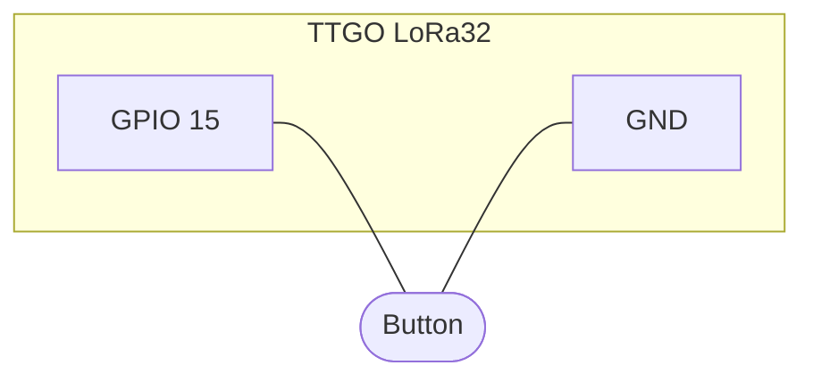
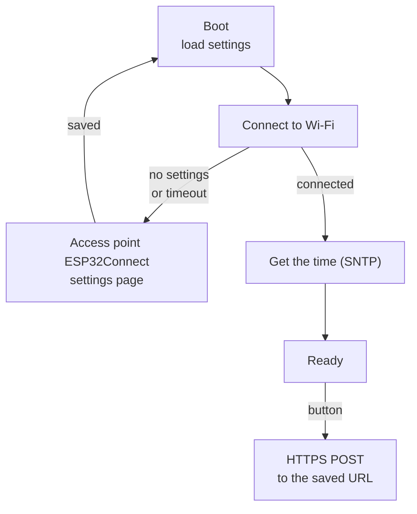

# TTGO LoRa32: Wi-Fi captive portal

A TTGO LoRa32 example that connects the ESP32 to **Wi-Fi** and sends a **notification over HTTPS** when a button is pressed. On the first start there are no saved settings, so the board opens its own access point with a **captive portal**: a phone that joins it is taken to the settings page automatically.

> **Status:** works end to end: portal, Wi-Fi, SNTP time, button, HTTPS notification. Reconnect after a Wi-Fi drop is still to do. The detailed design is in [HOW_IT_WORKS.md](HOW_IT_WORKS.md).

## Wiring

Only the button is external. It connects between **GPIO 15** and **GND**. No resistor is needed, because the pin uses the ESP32's internal pull-up (`INPUT_PULLUP`):

- **Released:** the pull-up holds the pin at 3.3V, so it reads `HIGH`.
- **Pressed:** the button shorts the pin to GND, so it reads `LOW`.



```
            TTGO LoRa32
          ┌─────────────────┐
          │                 │      Button
          │         GPIO 15 ├──────o  o──────┐
          │                 │                 │
          │             GND ├─────────────────┘
          └─────────────────┘
```

> **4-pin tactile buttons:** the two pins on each long side are connected internally. Use two **diagonally opposite** pins so you're sure to go through the switch.

| Signal | ESP32 pin | Notes |
|---|---|---|
| LED | GPIO 25 | onboard, status indicator |
| **Button** | GPIO 15 | to GND, internal pull-up. Strapping pin: held at boot, it silences the UART boot log |
| Debug 1 | GPIO 13 | logic analyzer marker, set LOW at boot, not used yet |
| Debug 2 | GPIO 14 | logic analyzer marker, set LOW at boot, not used yet. Short PWM at boot |

Pin assignments are defined in [include/config.h](include/config.h). Wi-Fi is inside the ESP32.

## How it works



1. On start-up the board reads the Wi-Fi network and the notification URL from **NVS** and tries to connect for up to 10 s.
2. **No settings, or the connection fails** → the board scans the networks around and starts an open access point **`ESP32Connect`**. A phone that joins it opens the **settings page** by itself (captive portal). The page asks for the network (from the scanned list, or typed by hand), the password and the **URL** for notifications. The board checks the values, saves them to NVS and restarts.
3. **Connected** → the board gets the time over **SNTP** (time zone Europe/Kyiv) and starts listening to the button.
4. **Button pressed** → the board sends a text notification with the press type and time to the saved URL, for example `Double press detected at 2026-11-13 14:05:01.`

Every part runs in its own **FreeRTOS task**, and the tasks talk through **queues**. The button task has the highest priority, so a slow HTTPS request never delays a press.

### LED

| Mode | Pattern |
|---|---|
| Connecting, getting the time, restarting | blinks 250 ms on / 250 ms off |
| Settings portal | double blink + pause |
| Ready | steady on |

### Button

| Press | Notification text |
|---|---|
| Single click | `Single press detected at ...` |
| Double click | `Double press detected at ...` |
| Long press (from 0.8 s) | `Long press detected at ...` |

A single click is sent about 400 ms after the release: the board waits that long for a possible second click.

### Notifications

The text is sent in the body of an **HTTPS POST** (`text/plain`). For testing, [ntfy.sh](https://ntfy.sh) shows it as a push on the phone: use `https://ntfy.sh/<random-topic>` as the URL and subscribe to the same topic in the ntfy app.

The server certificate is not checked yet (`setInsecure()`): the traffic is encrypted, but the server is not verified.

## Services

The code has three layers: **drivers** (hardware and transport), **services** (the domain), and **app** (the state). Dependencies only go down. See [HOW_IT_WORKS.md](HOW_IT_WORKS.md#architecture) for the details.

| Class | What it does |
|---|---|
| `app::App` | Owns the state (`Loading` → `Online` or `Provisioning`). Takes events from one queue and calls the services. |
| `services::SettingsStore` | Loads and saves the Wi-Fi and URL settings in NVS. Falls back to `include/secrets.h` for development. |
| `services::Net` | Connects to Wi-Fi in station mode, posts `WiFiUp` or `WiFiFailed`. |
| `services::SetupPortal` | Captive portal: network scan, access point, DNS that answers every name with the board, web server with the settings page and form validation. |
| `services::WorldClock` | SNTP time with the Kyiv time zone; turns a `millis()` timestamp into wall-clock time; formats it. |
| `services::IsrButton` | Wakes the button task from an interrupt, lets OneButton detect single / double / long presses, posts `ButtonPressed`. |
| `services::Notifier` | Turns an event into a text with the time and hands it to the transport, in its own low-priority task. Posts `NotifyDone` with the HTTP status. |
| `drivers::Led` | Plays LED patterns (`Off`, `On`, `Blink`, `DoubleBlink`) in its own task. |
| `drivers::HttpsTransport` | Sends a notification as an HTTPS POST. Implements the `drivers::Transport` interface. |

## Code structure

| Path | What it does |
|---|---|
| [src/main.cpp](src/main.cpp) | Loads the settings, creates the event queue and all objects, wires them and starts `App` |
| [src/app/](src/app/) | `app::App`: state owner, event switch |
| [src/services/](src/services/) | `SettingsStore`, `Net`, `SetupPortal`, `WorldClock`, `IsrButton`, `Notifier` |
| [src/drivers/](src/drivers/) | `Led`, `Transport` (interface), `HttpsTransport` |
| [include/event.h](include/event.h) | `Event`, `EventType_t`, `ButtonEvent_t`: shared by all layers |
| [include/event_factory.h](include/event_factory.h) | `createEvent()`: fills the timestamp |
| [include/notification.h](include/notification.h) | `Notification`: shared by `Notifier` and the transports |
| [include/settings.h](include/settings.h) | `WifiSettings`, `NotificationSettings` |
| [include/config.h](include/config.h) | Pin assignments |
| [include/helpers.h](include/helpers.h) | `PANIC()` and `HALT()` macros |
| [include/secrets.example.h](include/secrets.example.h) | Template for `secrets.h` (development defaults, not in git) |
| [data/setup_portal/setup.html](data/setup_portal/setup.html) | Settings page, uploaded to LittleFS |

## Build and run

```sh
pio run -t uploadfs   # settings page → LittleFS
pio run -t upload
pio device monitor
```

For development, the Wi-Fi and the URL can come from `include/secrets.h` instead of the portal. The file is not in git: copy it from `include/secrets.example.h` and fill it in. The defaults are used only while NVS has no saved settings, so a value saved in the portal wins. To go back to the defaults or to the portal, erase the flash: `pio run -t erase`, then `uploadfs` and `upload` again.

The serial monitor runs at 115200 baud. Logs use the ESP-IDF `log_*` macros, the level is set by `CORE_DEBUG_LEVEL` in [platformio.ini](platformio.ini) (4 = debug, 5 = verbose).
