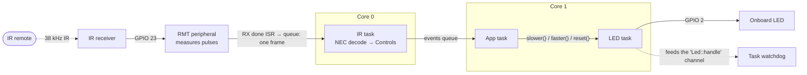

# ESP32: tasks on two cores and watchdogs

An ESP32 DevKit v1 example about FreeRTOS tasks on **two cores** and the **task watchdog**. An **IR remote** changes the blink interval of the onboard LED. The remote is decoded by the ESP32 **RMT** peripheral, and the key presses travel between the cores through a **FreeRTOS queue**. The **#** key hangs the LED task on a mutex on purpose, and the task watchdog catches the hang and reboots the board.

## How it works



1. The **RMT** peripheral measures the pulses from the IR receiver in hardware. When the line stays idle longer than `signal_range_max_ns` (12 ms), the frame is complete and the RX done callback runs in an interrupt. It only copies the event (pointer + symbol count) into a one-slot queue.
2. The **IR task** (core 0) wakes on that queue, decodes the NEC frame, checks `command ^ ~command == 0xFF` and maps the code to a key. Repeat frames (a held button) are skipped, so one press is one step. Then it arms the receiver again with `rmt_receive()`: the receive is one-shot.
3. **`Controls`** gets the key through a callback, still in the IR task, and puts a `ControlPressed` event into the events queue. The value is `0` for **Up**, `1` for **Down**, `2` for **#**.
4. The **App task** (core 1) reads the queue: **Up** → `slower()`, **Down** → `faster()`, **#** → `reset()`.
5. The **LED task** (core 1) blinks with the interval of the current step: on for the interval, off for the interval. The step index is protected by a mutex. At the start of every cycle the task feeds its watchdog channel.

| Step | Interval | Up → | Down → |
|---|---|---|---|
| 0 | 0.25 s | 0.5 s | 2 s |
| 1 | 0.5 s | 1 s | 0.25 s |
| 2 | 1 s | 2 s | 0.5 s |
| 3 | 2 s | 0.25 s | 1 s |

**Up** makes the interval longer, **Down** makes it shorter, both go in a circle. **#** goes back to step 0 and hangs the LED task, see [The hang on purpose](#the-hang-on-purpose).

### Tasks

| Task | Core | Priority | Stack | Waits on | Watchdog |
|---|---|---|---|---|---|
| IR task | 0 | 3 | 4096 | RMT RX queue (1 slot), forever | no |
| App task | 1 | 2 | 4096 | events queue (20 slots), forever | no |
| LED task | 1 | 1 | 2048 | the mode mutex, then `vTaskDelay` | `Led::handle`, 10 s |

The stack sizes are a guess. _TODO:_ measure the real use with `uxTaskGetStackHighWaterMark()` and size the stacks from it.

The RMT channel is created inside the IR task, not in `setup()`, so its interrupt also runs on core 0: ESP-IDF allocates an interrupt on the core that creates the channel.

### Remote

The remote has 17 keys and speaks **NEC**, address `0x00`. Codes used:

| Key | NEC command | Action |
|---|---|---|
| Up | `0x46` | one step forward: longer interval |
| Down | `0x15` | one step back: shorter interval |
| # | `0x4A` | back to step 0, then the LED task hangs on the mutex |

**NEC in short:** the receiver output is active-low. A frame is a 9 ms burst, a 4.5 ms space, then 32 bits, least significant bit first: `address`, `~address`, `command`, `~command`. Every bit is a 560 µs burst, followed by a 560 µs space for `0` or a 1690 µs space for `1`. A held key sends short repeat frames every 108 ms.

## Watchdogs

### What ESP-IDF already has

| Watchdog | Catches | Setting here |
|---|---|---|
| **Interrupt WDT** | interrupts disabled for too long, a stuck ISR | 300 ms, both cores (default) |
| **Task WDT** (TWDT) | a subscribed task or user did not report in time | **10 s** (default 5 s), panic and reboot |

The default setup only catches a task that **keeps the CPU busy**: then the IDLE task never runs and cannot report. A task that is **blocked** forever, on a mutex or on a queue, is invisible to it: the CPU is free, IDLE runs and reports as usual. A deadlock is exactly such a case, so a task has to report by itself.

### Own channel for the LED task

ESP-IDF 5 can subscribe a **user** to the TWDT, not only a task. A user is a named channel with a handle that any code can feed.

There is **one timeout for all** subscribers: tasks, users and IDLE.

## Wiring

The IR receiver module has three pins: **G** (GND), **R** (VCC), **Y** (signal). The **L** on the board is an indicator LED that flickers on every frame.

```
          ESP32 DevKit v1              IR receiver module
        ┌─────────────────┐           ┌─────────────────┐
        │             3V3 ├───────────┤ R   VCC         │
        │         GPIO 23 ├───────────┤ Y   OUT         │
        │             GND ├───────────┤ G   GND         │
        └─────────────────┘           └─────────────────┘
```

Power the module from **3.3V**, not 5V: its output idles at the supply voltage, and the ESP32 pins are 3.3V only.

| Signal | ESP32 pin | Notes |
|---|---|---|
| LED | GPIO 2 | onboard |
| IR receiver `OUT` | GPIO 23 | RMT input, idle `HIGH` |

Pin assignments and the watchdog timeout are defined in [include/config.h](include/config.h).

## Code structure

Three layers, dependencies only go down (see [ARCH_GUIDE.md](../ARCH_GUIDE.md)). The app and the service know only the driver interfaces.

| Path | What it does |
|---|---|
| [src/main.cpp](src/main.cpp) | Prints the reset reason, creates the objects and the events queue, sets up the watchdog, starts everything |
| [src/app/app.cpp](src/app/app.cpp) | `app::App`: App task, reads the events queue, drives the `Blinker` |
| [src/services/controls.cpp](src/services/controls.cpp) | `services::Controls`: turns a key from `RmtKeyboard` into an event in the queue |
| [src/drivers/rmt_keyboard.h](src/drivers/rmt_keyboard.h) | `RmtKeyboard` interface and the `RmtKeyboardKey` enum |
| [src/drivers/ir_keyboard.cpp](src/drivers/ir_keyboard.cpp) | `IRKeyboard`: RMT RX channel, RX done callback, IR task, NEC decoding |
| [src/drivers/blinker.h](src/drivers/blinker.h) | `Blinker` interface |
| [src/drivers/led.cpp](src/drivers/led.cpp) | `Led`: LED task, the interval steps, the mode mutex, the `Led::handle` watchdog channel |
| [include/event.h](include/event.h) | `Event`: type, time, value |
| [include/watchdog.h](include/watchdog.h) | `watchdog::begin()`: TWDT timeout, panic, IDLE subscriptions |
| [include/reset_info.h](include/reset_info.h) | `getEspReasonName()`: `esp_reset_reason_t` → name |


## Build and run

```sh
pio run -t upload
pio device monitor
```
