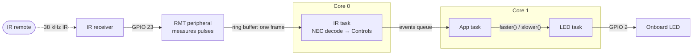

# ESP32: tasks on two cores and watchdogs

An ESP32 DevKit v1 example about FreeRTOS tasks on **two cores**. An **IR remote** changes the blink interval of the onboard LED. The remote is decoded by the ESP32 **RMT** peripheral, and the key presses travel between the cores through a **FreeRTOS queue**.

> **Status:** the remote, the tasks and the LED work. [Breaking it on purpose](#next-break-it-and-add-watchdogs) is next.

## How it works



1. The **RMT** peripheral measures the pulses from the IR receiver in hardware. When the line goes idle after a frame, the driver puts the whole frame into a ring buffer.
2. The **IR task** (core 0) wakes on the ring buffer, decodes the NEC frame, checks `command ^ ~command == 0xFF` and maps the code to a key. Repeat frames (a held button) are skipped, so one press is one step.
3. **`Controls`** gets the key through a callback, still in the IR task, and puts a `ControlPressed` event into the events queue.
4. The **App task** (core 1) reads the queue: **Up** → `faster()`, **Down** → `slower()`. They move the step index of the LED in a circle.
5. The **LED task** (core 1) blinks with the interval of the current step: on for the interval, off for the interval.

| Step | Interval | Up → | Down → |
|---|---|---|---|
| 0 | 0.25 s | 0.5 s | 2 s |
| 1 | 0.5 s | 1 s | 0.25 s |
| 2 | 1 s | 2 s | 0.5 s |
| 3 | 2 s | 0.25 s | 1 s |

### Tasks

| Task | Core | Priority | Stack | Waits on |
|---|---|---|---|---|
| IR task | 0 | 3 | 4096 | RMT ring buffer, forever |
| App task | 1 | 2 | 4096 | events queue (20 slots), forever |
| LED task | 1 | 1 | 2048 | `vTaskDelay` |

The stack sizes are a guess. _TODO:_ measure the real use with `uxTaskGetStackHighWaterMark()` and size the stacks from it.

The RMT driver is installed inside the IR task, not in `setup()`, so its interrupt also runs on core 0: ESP-IDF allocates an interrupt on the core that installs it.

### Remote

The remote has 17 keys and speaks **NEC**, address `0x00`. Codes used:

| Key | NEC command | Action |
|---|---|---|
| Up | `0x46` | one step forward |
| Down | `0x15` | one step back |
| # | `0x4A` | will trigger the mutex hang in [the next part](#next-break-it-and-add-watchdogs). Decoded, not used yet |

**NEC in short:** the receiver output is active-low. A frame is a 9 ms burst, a 4.5 ms space, then 32 bits, least significant bit first: `address`, `~address`, `command`, `~command`. Every bit is a 560 µs burst, followed by a 560 µs space for `0` or a 1690 µs space for `1`. A held key sends short repeat frames every 108 ms.

## Wiring

The IR receiver module has three pins: **G** (GND), **R** (VCC), **Y** (signal). The **L** on the board is an indicator LED that flickers on every frame.

```
          ESP32 DevKit v1              IR receiver module
        ┌─────────────────┐           ┌─────────────────┐
        │             3V3 ├───────────┤ R   VCC         │
        │         GPIO 23 ├───────────┤ Y   OUT         │
        │             GND ├───────────┤ G   GND         │
        └─────────────────┘           └─────────────────┘
```

Power the module from **3.3V**, not 5V: its output idles at the supply voltage, and the ESP32 pins are 3.3V only.

| Signal | ESP32 pin | Notes |
|---|---|---|
| LED | GPIO 2 | onboard |
| IR receiver `OUT` | GPIO 23 | RMT input, idle `HIGH` |

Pin assignments are defined in [include/config.h](include/config.h).

## Code structure

Three layers, dependencies only go down (see [ARCH_GUIDE.md](../ARCH_GUIDE.md)). The app and the service know only the driver interfaces.

| Path | What it does |
|---|---|
| [src/main.cpp](src/main.cpp) | Creates the objects and the events queue, starts everything |
| [src/app/app.cpp](src/app/app.cpp) | `app::App`: App task, reads the events queue, drives the `Blinker` |
| [src/services/controls.cpp](src/services/controls.cpp) | `services::Controls`: turns a key from `RmtKeyboard` into an event in the queue |
| [src/drivers/rmt_keyboard.h](src/drivers/rmt_keyboard.h) | `RmtKeyboard` interface and the `RmtKeyboardKey` enum |
| [src/drivers/ir_keyboard.cpp](src/drivers/ir_keyboard.cpp) | `IRKeyboard`: RMT setup, IR task, NEC decoding |
| [src/drivers/blinker.h](src/drivers/blinker.h) | `Blinker` interface |
| [src/drivers/led.cpp](src/drivers/led.cpp) | `Led`: LED task and the interval steps |
| [include/event.h](include/event.h) | `Event`: type, time, value |

## Next: break it and add watchdogs

Plan: the **#** key hangs the tasks on a **mutex** on purpose. Then see which built-in watchdog fires and what it prints in the serial monitor, and add **own watchdogs** on top. _TBD._

## Build and run

```sh
pio run -t upload
pio device monitor
```

The serial monitor runs at 115200 baud. Logs use the ESP-IDF `log_*` macros, the level is set by `CORE_DEBUG_LEVEL` in [platformio.ini](platformio.ini) (4 = debug, 5 = verbose: raw RMT items of each frame).
